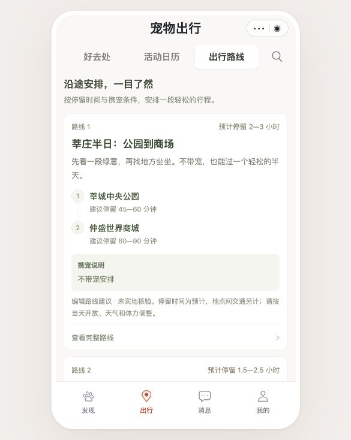
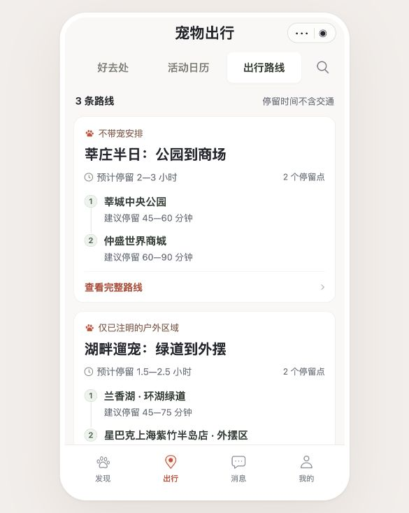
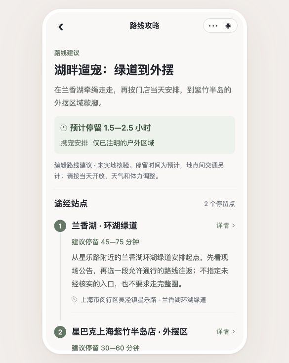

# 出行路线 UI 优化 · 2026-10-22

## 设计方案与实施前复核

沿用暖白 `#FAF8F5`、卡片白 `#FFFFFF`、墨色 `#24262D`、辅助灰 `#6A717B`、路线绿 `#5F7863`、操作珊瑚 `#CC4A37`。使用系统中文字体，列表标题 36–38rpx、站点 28rpx、正文 26rpx，主要触区至少 44px。

列表左对齐，先回答“怎么安排、多久、能否带宠”，再打开详细行程：

```text
出行路线                         搜索
3 条路线             停留时间不含交通
┌──────────────────────────────┐
│ 携宠范围                     │
│ 路线标题                     │
│ 预计停留时间          2 个停留点│
│ 1  第一站              停留建议│
│ │                            │
│ 2  第二站              停留建议│
│ 查看完整路线                 ›│
└──────────────────────────────┘
通用的未核验、交通另计与行前提示
```

复核：不使用虚构地图、未经核实的里程或连通步道；路线编号没有业务意义，去掉“路线 1/2/3”，仅保留表达实际停留顺序的站点编号。列表不重复长摘要和共同说明，完整摘要、具体条件与来源保留在详情。采用路线顺序、清晰字号和对比表达重点，不增加无信息的装饰图。

详情按“路线概览 → 逐站安排 → 行前条件 → 依据来源”展开。保持地点下架、来源和服务错误信息，沿用已有地点与导航入口。

## 改版前



## 完成情况

- 列表去掉无业务意义的路线编号和重复长摘要，合并通用说明；放大标题，前置携宠范围、预计时长和停留点数量。
- 站点顺序继续由原有路线数据提供；整张卡片使用原生按钮，可点击和聚焦。
- 详情突出路线概览，使用连续的编号站点展示行程；保留地点详情入口、行前条件、来源与异常状态，合并重复的未核验说明。
- 小屏正文、搜索框与主要操作触区调整；页面 JavaScript、路线数据、定位和导航逻辑未改动。

## 验证

- `npm run check` 通过，28 个页面配置与脚本正常。
- `npm test`：社区回归 897 项、私人资料隔离回归 40 项，共 937 项通过，0 失败。
- 最后样式与重复说明调整后，重新运行路线列表、路线详情和地点页面相关测试，通过。
- 微信官方离线编译通过：32 个 WXML 模板、33 份 WXSS；相关文件 `git diff --check` 通过。
- 浏览器检查 320px、375px 和默认预览尺寸；搜索“兰香湖”正确返回对应路线，无结果提示、清除/取消搜索、路线到地点详情、返回与来源展开均正常。
- 375px 检查时页面 `scrollWidth` 与可见宽度均为 375px，未出现横向溢出；浏览器未记录 error / warn。

只完成本地 UI 修改和验收，未上传微信。浏览器已停在“出行 → 出行路线”；原生地图能力仍需真机验收。

## 改版效果




