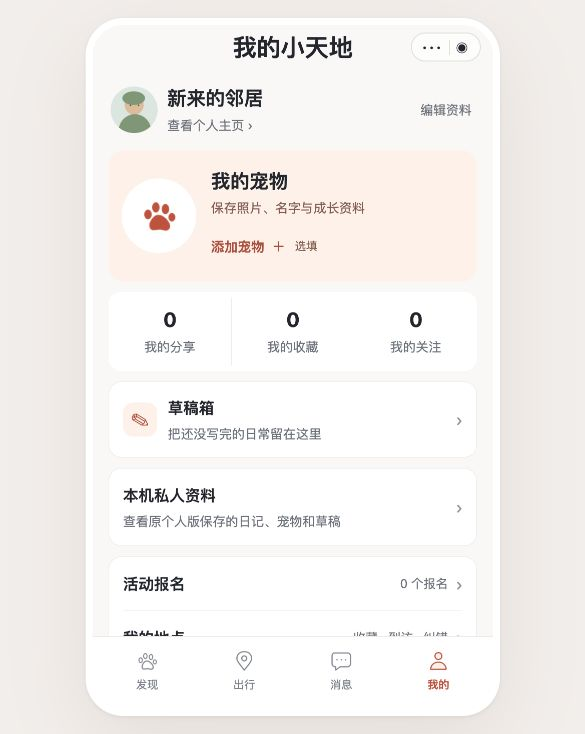

# UI 优化记录 · 2026-10-22

本轮为原生小程序的本地 UI 修改，覆盖“我的”、宠物档案、发现三个页面。没有上传微信或更改发布配置。

## 工具保留

组件库、示例仓库、许可证边界与原生适配说明已记录在 [UI 工具与设计规范](../docs/19-UI工具与设计规范.md)，并链接到 README。

本机已安装 `frontend-design` 与 `ui-ux-pro-max`。本轮读取并应用前者；后者保留供后续按需使用。没有新增小程序运行依赖。

## 页面改动

- **我的**：页标题增加至 24px，个人身份区收紧；宠物独立成卡片，照片区域大于主人头像，支持名字换行与年龄显示。无宠物时使用已有品牌图标和明确的添加入口。常用统计与菜单重新分组，辅助文字增大。
- **宠物档案**：宠物资料先于个人资料显示，首只宠物照片为 248rpx，后续为 224rpx，窄屏适配为 220rpx；主要编辑、照片操作和移除操作区分层级。添加表单打开时隐藏空状态，选项改用带选中语义的原生按钮，按钮和输入触区至少 44px。
- **发现**：品牌与内容导航区分层级；搜索框聚焦时展开，动物与话题筛选保留；卡片去掉外边框，标题增大、照片与文字留白更清楚，保留图片加载、失败重试与分页逻辑。

本轮修改的是三页的 WXML / WXSS，没有改动这些页面的 JavaScript、数据服务或用户隐私设置。原有私人资料库、草稿、照片审核与重试、清理保护继续保留。

## 验证结果

| 检查 | 结果 |
| --- | --- |
| `npm run check` | 28 个页面配置与脚本检查通过 |
| `npm run check:wechat` | 微信官方离线编译通过：32 个 WXML、33 份 WXSS |
| `npm test` | 社区回归 888 项通过；私人资料隔离回归 40 项通过；合计 928 项，0 失败 |
| 相关文件 `git diff --check` | 通过 |
| 浏览器视觉 | 检查默认预览、320px 与 375px 宽度；无宠物状态、长宠物名、添加/保存、搜索展开、无结果、动物筛选均可显示和操作 |
| 浏览器页面宽度 | 375px 宽度下发现页内容未横向溢出；可见控制与卡片布局正常 |
| 浏览器日志 | 测试标签中未记录 error / warn |

新增宠物等可写测试使用独立的 `127.0.0.1:4174` 本机预览来源，未操作用户原来的 `4173` 资料。原预览已刷新并停在“我的”页。

浏览器未上传测试宠物照片；照片流程由现有回归测试覆盖。微信真机的原生选图、胶囊、安全区与真实接口仍需在实际设备上检查。

## 当前个人页

